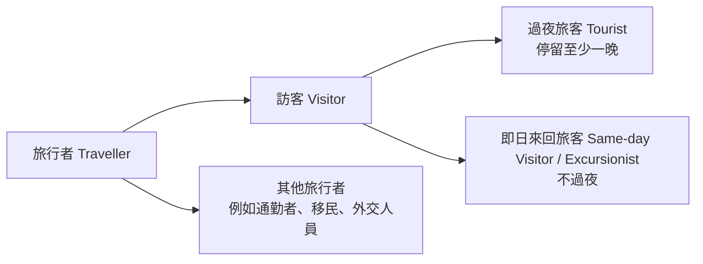
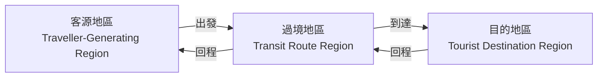

# 1. 旅遊導論

!!! abstract "本章重點"
    1. 旅遊的定義及旅客的分類
    2. 旅遊的形式和類型
    3. 旅遊動機：推力與拉力因素
    4. 旅遊系統及旅遊業的組成
    5. 旅遊的影響

---

## 1.1 旅遊的定義

根據**聯合國世界旅遊組織（UNWTO）**：

> 旅遊是指人們為了消閒、商務或其他目的，前往並停留在其**慣常環境以外**的地方，**連續不超過一年**的活動。

旅遊的定義有三個要素：

| 要素 | 說明 |
|---|---|
| 地點 | 離開**慣常環境**（日常生活的地方） |
| 時間 | **不超過一年**連續停留 |
| 目的 | 不是為了在目的地從事有報酬的工作 |

### 旅客的分類

!!! keyword "關鍵詞"
    - **訪客 Visitor**：前往慣常環境以外地方，停留不超過一年，且不是為了在當地受聘工作
    - **過夜旅客 Tourist**：在目的地**過夜至少一晚**的訪客
    - **即日來回旅客 Excursionist**：**當日離開**、不過夜的訪客（例如郵輪乘客上岸觀光）

---

## 1.2 旅遊的形式

=== "本地旅遊 Domestic"
    當地居民在**本國／本地區之內**旅遊。
    例：香港居民到大嶼山露營。

=== "入境旅遊 Inbound"
    **非當地居民**到訪該地。
    例：日本旅客來香港旅遊（對香港而言是入境旅遊）。

=== "出境旅遊 Outbound"
    當地居民**前往其他國家／地區**旅遊。
    例：香港居民到台灣旅遊。

!!! tip "記憶技巧"
    同一個旅程，從不同地方看會有不同的分類：香港人去日本，對**香港**是出境旅遊，對**日本**是入境旅遊。

---

## 1.3 旅遊的類型（按目的）

| 類型 | 英文 | 例子 |
|---|---|---|
| 消閒及度假 | Leisure & Recreation | 主題公園、海灘度假 |
| 商務 | Business | 參加會議、展覽、獎勵旅遊（MICE） |
| 探親訪友 | Visiting Friends & Relatives (VFR) | 回鄉探望親人 |
| 其他 | Others | 醫療旅遊、宗教朝聖、教育旅遊 |

---

## 1.4 旅遊動機：推力與拉力因素

-   :material-arrow-right-bold: **推力因素 Push Factors**

    ---

    **內在**的因素，推動人**想離開**家：

    - 逃離日常壓力
    - 放鬆休息
    - 尋求新奇刺激
    - 增進家庭關係
    - 提升社會地位

-   :material-magnet: **拉力因素 Pull Factors**

    ---

    **目的地本身**的吸引力，決定**去哪裡**：

    - 自然景觀、氣候
    - 文化及歷史遺產
    - 購物、美食
    - 交通方便、價錢合理
    - 安全、簽證便利

!!! exam "考試重點"
    題目常問：「解釋**兩個**推動香港人到日本旅遊的因素」。

    - 先**分清**推力（遊客自身）和拉力（目的地）
    - 每個因素用「**指出 → 解釋 → 舉例**」三步作答
    - 例：*拉力*：日本有**獨特的飲食文化**（指出），吸引想品嚐道地美食的旅客（解釋），例如到北海道品嚐海鮮（舉例）

---

## 1.5 旅遊系統（Leiper 模型）

- **客源地區**：旅客出發的地方，是推力因素所在
- **過境地區**：途經的地方，例如轉機的機場
- **目的地區**：旅客停留的地方，是拉力因素所在，也是受旅遊影響最大的地方

### 旅遊業的組成

| 界別 | 例子 |
|---|---|
| 住宿 | 酒店、賓館、度假村 |
| 餐飲 | 餐廳、酒吧 |
| 交通 | 航空公司、郵輪、鐵路 |
| 景點 | 主題公園、博物館 |
| 旅遊中介 | 旅行社、網上旅遊平台（OTA） |
| 支援機構 | 香港旅遊發展局、旅遊業監管局 |

---

## 1.6 旅遊的影響

| | 正面影響 | 負面影響 |
|---|---|---|
| **經濟** | 增加就業、外匯收入、帶動相關行業（乘數效應） | 過度依賴旅遊業、物價及租金上升、經濟漏損 |
| **社會文化** | 文化交流、保育傳統文化、改善基建 | 擠迫、文化商品化、主客衝突 |
| **環境** | 推動環境保育、資助保護區 | 污染、破壞生態、過度開發 |

!!! keyword "關鍵詞"
    - **乘數效應 Multiplier Effect**：旅客的消費在本地經濟中不斷流轉，帶來比原本消費**更大**的經濟效益
    - **經濟漏損 Leakage**：旅遊收入**流出**本地，例如外資酒店把利潤匯回本國、進口食材
    - **可持續旅遊 Sustainable Tourism**：同時顧及經濟、社會和環境，**滿足現在需要而不損害下一代**

!!! exam "考試重點"
    評論題（例如「旅遊業對香港利多於弊？」）要**平衡兩面**，最後給出**有理據的立場**，可提出**緩解負面影響的建議**（例如分流旅客、發展地區特色景點）。

---

## 自我測驗

??? question "1. 一名內地旅客早上乘高鐵來港購物，晚上返回深圳。他屬於哪類訪客？"
    **即日來回旅客（Excursionist）**：沒有在香港過夜。

??? question "2. 「香港的米芝蓮餐廳數目多」屬於推力還是拉力因素？"
    **拉力因素**：屬於目的地本身的吸引力。

??? question "3. 解釋什麼是「經濟漏損」，並舉一例。"
    旅遊收入沒有留在本地經濟而流出外地。例：國際連鎖酒店把利潤匯回總部所在國家。

- [ ] 我能分辨過夜旅客與即日來回旅客
- [ ] 我能舉例說明三種旅遊形式
- [ ] 我能用「指出 → 解釋 → 舉例」回答推拉因素題
- [ ] 我能平衡分析旅遊的正負面影響
