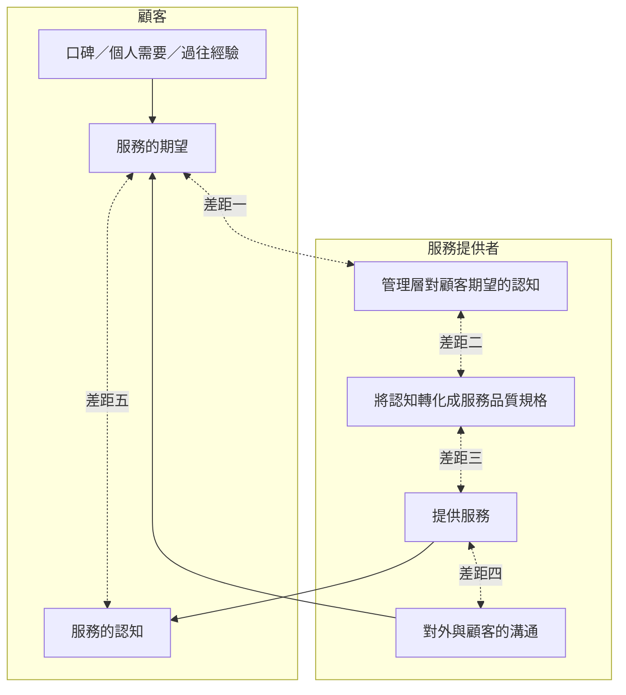

# 2. 顧客服務概念

出題頻率：服務品質差距模式 ⭐⭐⭐⭐⭐（2015、2016、2017、2018、2019、2020、2021、2023、2024、2025）｜顧客忠誠度計劃 ⭐⭐⭐⭐（2026 考評報告點名弱項）｜關鍵時刻 ⭐⭐⭐

---

## 2.1 顧客需要、期望、認知及滿意度

| 概念 | 定義 |
|---|---|
| ==需要== | 維持生命的基本所需（如氧氣、水、食物）；可按==馬斯勞需求理論==分層；**一生持久不變** |
| ==願望== | 個人的即時或未來慾望；**因人而異、隨時間改變**；由文化、個性及經歷塑造 |
| ==需求== | 顧客擁有==購買力==時，願望便轉化為需求 |
| ==顧客期望== | 顧客滿足需要及願望時，希望獲得的所有利益；須在公司能力範圍內，保持「合理」 |
| ==顧客認知== | 顧客對產品／服務的感受和想法；主要由==過往經驗==形成，亦受==口碑==及==廣告==影響 |
| ==顧客滿意度== | 體驗後**認知符合或超過期望**，顧客才感滿意 |

!!! note "公式"
    **==滿意度== ＝ ==認知== － ==期望==**

    - 認知 ≥ 期望 → 滿意
    - 認知 ＜ 期望 → 不滿

### 馬斯勞需求理論應用於款待業

| 層次 | 需要 | 款待業例子 |
|---|---|---|
| 1 ==生理需要==（最低） | 食物、水、睡眠、氧氣、活動 | 用膳只為填飽肚子 |
| 2 ==安全需要== | 穩定、沒有威脅的環境 | 出門到外地入住酒店 |
| 3 ==歸屬感及關愛的需要== | 得到關愛及同輩認同 | 酒吧、俱樂部、的士高、體育會 |
| 4 ==受尊敬的需要== | 自重、自尊、受人尊重 | 選擇時髦、高檔、時尚的地方 |
| 5 ==實現自我的需要==（最高） | 實現自我、發揮潛能 | 假期、活動、宴會 |

### 顧客期望的內容

- **對產品及服務**：適切的產品或服務、合理的價錢、最合適的時間、最合適的地點、由積極熱心的員工提供
- **對服務員**：聆聽、理解、關心、迎合個人需要、靈活對待

### 達至顧客期望的方法

1. **重視顧客**：寄感謝信、生日咭；未能即時接待時微笑或示意稍等
2. **禮貌待人**：用「請」「謝謝」；遇投訴耐心聆聽，無法解決便請同事協助
3. **把握時間**：不怠慢正在接待的顧客，亦不讓等候的顧客等太久
4. **服務熱情**：微笑、熱情接待、積極處理問題
5. **全心投入**：從顧客角度理解真正需求（如安排說普通話的員工接待北京客人）

### 普通與卓越服務

| 行為／態度 | 普通 | 卓越 |
|---|---|---|
| 專注 | 留心傾聽 | 同時回應「是的」「我明白」，多眼神接觸 |
| 說出顧客名字 | 說一次 | 對話中多次使用 |
| 聆聽技巧 | 留心傾聽 | 總結並確認所聽內容 |
| 友善態度 | 「謝謝你，先生。」 | 「還有甚麼我能幫忙呢？」 |
| 樂於助人 | 告訴的士公司電話 | 代為召喚的士 |

---

## 2.2 顧客終身價值及忠誠度

- ==顧客終身價值==：顧客光顧產生的現有價值，加上將來繼續光顧帶來的流轉現金
- ==顧客忠誠度==：顧客承諾與某機構進行買賣，**重複購買**並**向別人介紹**其產品和服務

### 留住顧客的好處

- 吸引新顧客的開支較留住現有顧客**高五至十倍**
- 忠誠度越高，用於吸引新顧客的開支越少（但吸引新顧客亦同樣重要）
- 忠誠度提高 → 顧客對==價格敏感性==降低 → 轉投其他品牌的機會較低

### ==顧客忠誠度計劃==

**定義**：獎勵顧客在某商店或一組商店購物，商店從而獲得更大份額的顧客消費；顧客花費越多，獎勵越多（折扣，或累積分數換取「免費」產品或服務）。

=== "對企業的好處"
    - 留住忠誠顧客成本較少（吸引新顧客開支高五至十倍）
    - 平均每個忠誠旅客會向 **12 人**推薦
    - 忠誠旅客更有可能向管理層**反映意見**
    - 忠誠顧客很少關注價錢，願付較高價錢；現有顧客較新顧客**多花 67%**
    - 培養顧客與企業之間深厚聯繫
    - 平均成本只佔銷售額 0.5%–1%；==顧客數據庫==可收集、存儲及查閱消費情況，了解每位顧客的興趣

=== "對顧客的好處"
    - 與同一公司交易，消除心理疑慮（已建立信任）
    - 感覺自己是精明的購物者
    - 從消費中累積有實用價值的好處
    - 從服務和產品中得到增值
    - 級別計劃中獲得公司的尊重（消費越多，級別待遇越高）

### 忠誠度計劃的三種類型

| 類型 | 運作 | 適用／特點 | 例子 |
|---|---|---|---|
| ==簡單的計分計劃== | 回頭客賺取積分，兌換折扣、贈品或優惠 | 最常見；鼓勵顧客在**短時間內經常購買**；提取**短期價值** | 咖啡店集滿 10 分送一杯；買 5 送 1 |
| ==級別計劃== | 初期給小獎賞，忠誠度增加後獎賞價值提高 | 提取**長期價值**；適合要求**較高承諾及較高價格**的企業（航空公司、酒店）；解決顧客忘記積分、從不兌換的問題 | 航空公司四個會籍級別 |
| ==夥伴計劃== | 與**非競爭企業**組成夥伴，促進累積積分、增加獎勵選擇 | 最常見於旅遊與款待業；有效保留客人、帶動公司增長 | 航空公司飛行常客會員與銀行信用卡積分互換 |

### 科技的應用

- 技術：電腦條碼、磁帶、==無線射頻（RFID）==（如八達通）、==流動條碼==
- 對顧客：無需更新損壞或丟失的紙咭；結餘容易查閱和更新
- 對企業：減少印刷、數據化儲存優惠券、以電郵通知優惠 → 減少營運支出
- ==流動條碼==的好處：**綠色**（無紙張或塑膠廢物，提升環保形象）、**低成本**（無需印刷、寄出、發行咭）、**提高品牌知名度**（直接透過手提電話宣傳）

!!! score "拿分要訣"
    - 分清題目問「對**企業**」還是「對**顧客**」的好處，不可混答
    - 辨識類型時，須引資料的**運作特徵**作證據（如「按消費額分不同會籍」→ 級別計劃；「與信用卡公司互換積分」→ 夥伴計劃）
    - 2026 考評報告指出考生對忠誠度計劃掌握不足，且未能以**解釋及資料證據**支持答案

---

## 2.3 提供顧客服務所涉及的文化議題

員工須熟悉不同文化之間的主要差異，並對文化議題保持敏感，否則易犯錯、令顧客難堪、損害顧客對服務的印象。

### 東方和西方傳統的差異

| ==東方傳統==（中國、日本、朝鮮、印度、新加坡） | ==西方傳統==（美國、英國、意大利、德國、法國） |
|---|---|
| 重視親情和血緣 | 簡單實用（務實性） |
| 謙遜、含蓄 | 崇尚個性自由 |
| 承認現實、滿足現狀 | 惜時如金 |
| 強調共性（整體性） | 自由、平等、開放 |
| 禮尚往來 | |

### ==禮儀==

**三大基本要素**：語言（書面及口頭）、行為表現、服飾器物

| 四種常見禮儀 | 定義 | 例子 |
|---|---|---|
| ==禮賓== | 人際、社會及國際交往中相互表示尊重及友好的行為規範 | — |
| ==禮節== | 日常及特別交際場合中相互問候、致意、祝願、慰問的慣用形式 | 點頭、握手；印度雙手合十；歐美擁抱、接吻 |
| ==禮貌== | 透過言談、表情、姿勢表示謙虛、恭敬和友好的言行規範 | 儀容儀表儀態、談吐、衣著髮型、表情姿勢、待人接物 |
| ==儀式== | 正式活動或場合所說及做的事情 | 檢閱儀仗、鳴放禮炮、剪綵、奠基 |

**旅遊禮儀的功能**：

1. 增進從業員與遊客之間的相互了解和溝通
2. 幫助處理旅客與東道主的爭執
3. 改善從業員的行為
4. 提升服務質素

### 不同國家的行禮禮儀

| 禮儀 | 要點 |
|---|---|
| 握手 | 起源於歐洲（表明手中沒有武器）；大多數國家接受；**與印度人握手不可用左手或雙手** |
| 鞠躬 | 韓國、日本等；彎腰時雙手平攤膝前，伴以問候 |
| 擁抱 | 須了解友誼深淺及風俗；異性見面最好由**女性主動示意** |
| 吻頰 | 一般只親吻右邊臉頰；西班牙、意大利較流行 |
| 其他 | 舉手禮（軍人）、合十禮（宗教）、吻手禮（歐美上層社會；女方不伸手則不行） |

**穩妥做法**：先以熱烈表情傳遞心意，觀察對方意願，再配合相應行禮方式。

---

## 2.4 提供優質顧客服務的挑戰

### ==關鍵時刻==

- 定義：顧客與員工交流時所產生的影響，給顧客留下**良好印象或令其不滿**；單一關鍵時刻已可積極或消極地改變整個服務體驗
- ==餐廳服務周期==的 **12 個接觸點**：初步接觸 → 餐廳入口 → 接待員 → 調酒師 → 餐桌狀況 → 見習侍應 → 餐廳服務員 → 餐廳經理 → 食物 → 洗手間 → 結賬 → 告別
- 每個接觸點都可能出現關鍵時刻；**前線員工**如何處理每次交流，影響顧客對整個服務過程的看法 → 前堂員工在防止==服務失誤==上扮演重要角色
- 例：初步接觸時惡劣的電話態度、錯誤訊息或不當指引，嚴重影響顧客對餐廳==可靠性==的看法

### ==服務品質差距模式==（Parasuraman、Berry、Zeithaml，1985）

用途：找出不同==服務接觸點==前後發生的問題，針對問題發展==服務提升==及==服務補救==計劃。

**差距五（==顧客差距==）受差距一至四（==服務提供者差距==）所影響。**

### 五個差距一覽

| 差距 | 名稱 | 公式 | 意思 | 課本例子 |
|---|---|---|---|---|
| 一 | ==認識差距== | 顧客期望 － 管理層對顧客期望的認知 | 管理層**不了解**顧客期望 | 顧客要廉價但清潔的酒店，管理層只懂削減成本，忽略清潔 |
| 二 | ==服務設計及標準差距== | 管理層對顧客期望的認知 － 服務質素的規範 | 管理層**知道**但受資源及承諾所限，**訂不出合標準的規範** | 酒店知道客人想盡快入住，但缺乏房務員及時交付==已清潔待售房間==（VC） |
| 三 | ==服務表現差距== | 服務質素的規範 － 實際所提供的服務質素 | **有標準**但員工未能按標準提供 | 服務員無禮令顧客不滿 |
| 四 | ==溝通差距== | 實際所提供的服務質素 － 與顧客的對外溝通 | 宣傳訊息**誇大**或與實際不符；隱藏收費 | 酒店廣告誇大設施，顧客抵步後有被騙感覺 |
| 五 | ==顧客差距== | 顧客期望 － 顧客認知 | 期望與接受服務後認知的差距；**決定滿意度和品質** | 認為餐廳食品不如朋友所說的好 |

### 各差距的成因（必背）

=== "差距一 認識差距"
    1. **==市場調查==不足及不全面**：沒有調查便無最新顧客偏好；只調查顧客買甚麼或對手策略，沒有針對服務質素
    2. **缺乏==對上溝通==**：管理層少到前線與顧客對話；低層員工不向上級匯報負面消息；大企業前線與管理層**多層之隔**
    3. **對建立關係的專注不夠全面**：著眼交易數量多於建立關係；注重吸引新客而非建立忠誠度
    4. **不足的服務補救**：不支持聆聽投訴（視投訴為麻煩）；沒有合適的==服務補救計劃==

=== "差距二 設計及標準差距"
    1. **差劣的==服務環境==**：服務環境（人力及物力編制）未能與崗位連繫，工作流程不暢；受成本及員工適應能力限制，未能保持及因時更新服務水平
    2. **欠缺==以顧客為驅動的標準==**：認知未能詮釋為良好服務標準，或為減成本而降低服務水平；以非正規方式制定標準（追隨同業標準，而非了解自身顧客）

=== "差距三 服務表現差距"
    1. **==人力資源政策==不足**：員工質素差劣（低技術職位入職要求低）；==角色模糊與角色衝突==；員工工作與科技未能配合（訓練不足）；不適當的==評估與獎勵制度==
    2. **顧客未盡本分**：顧客對自身角色缺乏認識（如遲到不知「==下午六時政策==」適用於==非保證訂房==）；顧客之間互相影響（高級餐廳內叫嚷、非吸煙區吸煙）
    3. **==中介服務==問題**：服務外判（如布草清洗交外判洗衣房），難以控制質量及穩定性
    4. **==季節性==問題**：旺季款接部擠滿客人，加快登記而減少個別關注

=== "差距四 溝通差距"
    1. **無效能的==顧客期望管理==**：沒有利用不同渠道清楚傳達政策（如不知須付 10% 服務費）
    2. **誇大的承諾**：==誇大的宣傳承諾==（單張稱五星，實際評級較低）；==誇大的個人銷售承諾==（旅遊顧問為生意誇大）
    3. **缺乏==橫向溝通==**：部門之間缺乏溝通（市場推廣部未通報營運部門，前線不知推廣細節）；不同分店政策及程序不同

!!! score "拿分要訣"
    - **四步作答**：指出差距（名稱＋編號）→ **引資料原句**作證據 → 以課本成因解釋 → 針對該成因提出改善
    - 每點必須扣緊資料情境；考評報告多次批評考生「僅抄錄或複述資料」或「未能應用於情境」
    - 答案須用課本詞彙（如「管理層對顧客期望的認知」「服務質素的規範」），不要只寫「酒店不好」

!!! trap "易錯"
    - **差距一 vs 差距二**：差距一是管理層**不知道**顧客要甚麼；差距二是**知道**但**訂不出**合適標準
    - **差距三 vs 差距四**：差距三是員工**做不到**既定標準；差距四是**宣傳／承諾**與實際不符
    - 差距五是**顧客**的差距，其餘四個是**服務提供者**的差距

---

- [ ] 能寫出滿意度公式及期望、認知的定義
- [ ] 能分辨三種忠誠度計劃並說出對企業／顧客的好處
- [ ] 能列出東西方傳統特點及四種禮儀
- [ ] 能寫出餐廳服務周期 12 個接觸點
- [ ] 能默寫五個差距的公式、例子及成因
